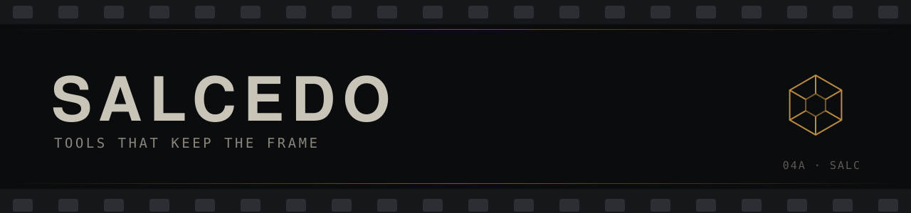
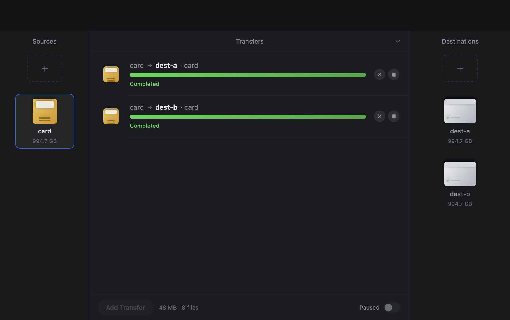
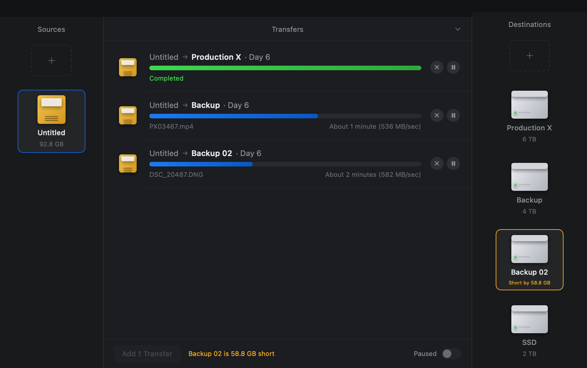

<div align="center">
  
</div>

<h1 align="center">FreeFileSync + Offload</h1>

<p align="center">A fork of FreeFileSync v14.12 that copies a camera card to several drives at once, hashes every byte, reads each copy back, and leaves a report you can check a year later.</p>

<p align="center">
  <a href="https://github.com/Salcedoandrew/freefilesync-offload/releases"></a>
  
  
  
</p>

## Download

`Offload-0.4.0-macos-arm64.zip` — 6.5 MB, 21 MB unzipped. The app carries its own libraries,
so the machine that runs it needs no Homebrew, wxWidgets or Xcode.

```bash
curl -LO https://github.com/Salcedoandrew/freefilesync-offload/releases/download/v0.4.0/Offload-0.4.0-macos-arm64.zip
shasum -a 256 Offload-0.4.0-macos-arm64.zip     # c2b0298a7920eff4153ae6525b1df7af464475a6aed147d5a07098b995093c7a
ditto -x -k Offload-0.4.0-macos-arm64.zip .
open Offload.app
```

> [!IMPORTANT]
> The build is ad-hoc signed, not notarized. `codesign --verify` passes, but Gatekeeper
> still asks once for a downloaded copy: right-click → **Open** → **Open**, or
> `xattr -d com.apple.quarantine Offload.app`. Notarizing needs an Apple Developer ID,
> which this build does not have. Intel Macs are not supported.

## The problem

A wedding card holds 92.8 GB and 1,284 files, and it has to exist on two drives before the
card is reformatted. Finder copies show a bar and nothing else: no proof the bytes that
landed are the bytes that left, no record of what was copied, and a drive that fills up
halfway through leaves a half-written destination that looks finished.

Offload copies to every destination at once, verifies each one by reading it back, and
writes the record into the destination itself.

## What it does

| You want | It does | How you can check |
|---|---|---|
| Two drives at once | One engine per destination, sharing the source hash | `--self-test CARD D1 D2` prints a verified count per destination |
| Proof, not a progress bar | XXH64 while writing, then every destination read back and compared | `report.csv` and `.ffsoffload.mhl` in each destination root |
| A refusal instead of a half copy | Source measured by the engine's own walk, destination free space checked before the first byte | `Backup 02 is 58.8 GB short` and **Add Transfer** disabled (screenshot 03) |
| A card that is never modified | Files opened read-only, published through a temp file and rename, identical files skipped | source tree hashes are identical before and after a run |
| Staying current | **Check for Updates…** verifies the download against the release checksum, then replaces the app | `--update-test`, `--update-selftest <feed>` |

## Build from source

Needs macOS 13+, Homebrew LLVM (`brew install llvm`), `glib`/`gettext`, and wxWidgets 3.3 —
the engine's `zen` layer uses `wxString` and its translation shim.

**Frame 01 — the engine**

```bash
cd FreeFileSync/Source
make -f Makefile.macos liboffloadapi.a ffsoffload ffsoffload_tests
```

**Frame 02 — the app, or just the archive**

```bash
cd offload/mac
make            # Offload.app, ad-hoc signed
make bundle     # wx/glib/gettext/libc++ copied into Contents/Frameworks
make zip        # Offload-<version>-macos-arm64.zip + its checksum
```

**Frame 03 — run it without the GUI**

```bash
./ffsoffload /Volumes/CARD /Volumes/Backup1 /Volumes/Backup2 \
             --report ~/Desktop/offload-report --mhl
```

## Updates

**Offload menu → Check for Updates…** asks the release feed, and if there is something
newer it replaces this copy of the app itself — no Sparkle, no helper daemon, no admin
prompt.

The order is deliberate: check, download, verify, *then* touch the installed app.

1. `releases/latest` from GitHub, compared as numbers (`0.10.0` is newer than `0.9.0`).
2. The zip is downloaded and its SHA-256 compared against the release's `SHA256SUMS.txt`.
   A single byte of difference stops the update there.
3. The archive is unpacked, and the bundle inside must have the same bundle id, the exact
   version in the tag, and a code signature that passes `codesign --verify --deep --strict`.
4. Only then a small script takes over: it waits for the app to quit, moves the old bundle
   aside, moves the new one in, re-verifies it, deletes the old bundle and reopens the app.
   Any failure puts the old bundle back and reopens that instead, and every attempt leaves
   one line in `~/Library/Application Support/Offload/update/last-swap.log`.

It refuses to run while transfers are in flight, and refuses to run at all from Gatekeeper's
read-only translocated copy (open the app from `/Applications` instead).

> [!WARNING]
> This verifies **integrity, not authorship**. The build is ad-hoc signed, so there is no
> Developer ID to check the download against: a compromised release would still pass every
> check above. Fixing that means notarization or a signed appcast, and both need an Apple
> Developer Program membership.

## Contact sheet

<table>
  <tr>
    <td width="50%"><br><sub><b>01</b> One card, three destinations, 536 and 582 MB/sec, one already verified</sub></td>
    <td width="50%"><br><sub><b>02</b> The mouse test's own fixture: both destinations green, 8 files each</sub></td>
  </tr>
  <tr>
    <td colspan="2"><br><sub><b>03</b> Refused before writing: <i>Backup 02 is 58.8 GB short</i>, and Add Transfer stays disabled</sub></td>
  </tr>
</table>

## How it is built

```text
FreeFileSync/Source/
├── offload/          the engine: copy, hash, verify, report, C ABI
│   ├── engine.cpp    walk the source, fan out to destinations, verify
│   ├── hash.cpp      XXH64, MD5, SHA-1, checked against xxhsum and shasum
│   ├── capi.cpp      the C surface the window speaks to
│   └── mac/          Offload.app: SwiftUI window, dylib bundler, packaging
├── base/             FreeFileSync's comparison and sync (unchanged)
└── afs/              its file-system layer (unchanged apart from the port)
```

The fork adds a new target beside `base/` and calls `afs` directly, so the Offload window
never touches FreeFileSync's `ui/` — which is the layer that still does not build on macOS.
The engine is compiled against Homebrew's LLVM and wxString, which is why the shipped app
bundles 25 dylibs rather than expecting them on the target machine.

The thinking behind it, with the measurements and the refusals, is in
[docs/offload/](docs/offload):

| Document | What it covers |
|---|---|
| [plan.md](docs/offload/plan.md) | the plan, the licence question, and what is left |
| [architecture-map.md](docs/offload/architecture-map.md) | what FreeFileSync gives you, and what breaks on macOS |
| [spec-offshoot-ux.md](docs/offload/spec-offshoot-ux.md) | the workflow this follows |
| [phase0-spike-report.md](docs/offload/phase0-spike-report.md) | does the engine build and run on macOS |
| [phase1-report.md](docs/offload/phase1-report.md) | the headless engine, with numbers |
| [phase2-report.md](docs/offload/phase2-report.md) | the window, the fit check, and the mouse test |

## What it costs

Measured on arm64 macOS 26.5, 2026-10-25 and 2026-10-26, on the packaged build where noted.

| | Cost | Measured with |
|---|---|---|
| Copy 64 MiB to one destination | 1.26 GiB/s | phase 0 `smoke_copy` |
| 191 MB card, 20 files, two destinations, hashed and read back | 0.49 s | `--self-test`, packaged app |
| Peak memory on that run | 19 MB | `/usr/bin/time -l` |
| Engine assertions | 107 pass | `./ffsoffload_tests` |
| Fit-check boundaries | 11 pass | `./Offload --fit-test` |
| Mouse checks against the real window | 12 pass | `make ui-test` |
| Update checks: versions, feed, checksums, a real bundle swap | 38 pass | `--update-test` |
| App bundle | 21 MB, 25 bundled dylibs | `du -sh Offload.app` |

Read-back verification means every byte crosses the bus roughly three times instead of
once, so throughput is bounded by the slowest destination, not by the source.

## Limits

- **No resume journal.** An interrupted job restarts that file; it does not continue mid-file.
- **The updater trusts the release it downloads.** Ad-hoc signing means the checksum proves
  the bytes arrived intact, not who published them.
- **v0.4.0 cannot update itself.** It predates this feature, so that upgrade is manual; every
  build from 0.5.0 on can.
- **The FreeFileSync GUI is not here.** This fork carries the engine and Offload only.
- **arm64 only.** The engine and its Homebrew dependencies are arm64, so an Intel build
  would need a dependency set that does not exist on the build machine.
- **Ad-hoc signed, not notarized.** Gatekeeper asks once; see the note above.
- **No real camera card or drive has been through it yet.** Every number here is a
  synthetic fixture on internal storage.
- **Nothing is upstreamed.** Upstream is a read-only mirror and does not take pull requests.

## Reel

| Version | Date | What changed |
|---|---|---|
| [v0.4.0](https://github.com/Salcedoandrew/freefilesync-offload/releases/tag/v0.4.0) | 2026-10-26 | Packaged, self-contained, signed app on the release; mouse-driven UI tests |
| [v0.3.1](https://github.com/Salcedoandrew/freefilesync-offload/releases) | 2026-10-25 | Destination fit check: refuses a drive that cannot hold the card |
| [v0.3.0](https://github.com/Salcedoandrew/freefilesync-offload/releases) | 2026-10-25 | The window, the C ABI, CSV/MHL reports, the `.app` bundle |
| [v0.2.1](https://github.com/Salcedoandrew/freefilesync-offload/releases) | 2026-10-25 | `--hash` selection, pause/resume, a stale-object crash fix |
| [v0.2.0](https://github.com/Salcedoandrew/freefilesync-offload/releases) | 2026-10-25 | The headless engine: 107 assertions, 221 files verified end to end |
| [v0.1.0](https://github.com/Salcedoandrew/freefilesync-offload/releases) | 2026-10-25 | The macOS port: 125 lines, all inside `__APPLE__` |

## Licence

[GPLv3](License.txt) — and upstream's own terms, which are narrower than the GPL. Both are
recorded in [NOTICE.md](NOTICE.md) without pretending the conflict is resolved. This is a
modified fork of [FreeFileSync](https://freefilesync.org) v14.12 (upstream commit
`53143e29`), not affiliated with, endorsed by, or distributed by its authors.

<div align="center">
  
  <sub>Salcedo Andrew · built for the 2 a.m. card dump · <a href="#top">back to the top</a></sub>
</div>
