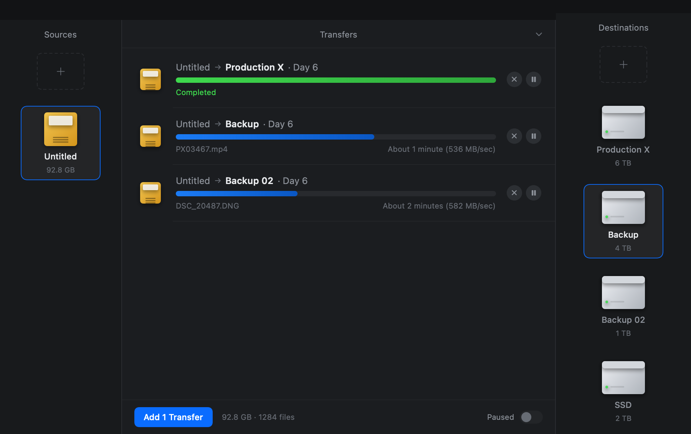

# FreeFileSync + Offload (macOS)

A **modified fork** of [FreeFileSync](https://freefilesync.org) v14.12 that adds
**Offload mode**: copy a camera card to several drives at once, hash every byte on the way
through, read each copy back, and leave a verified report behind.

Not affiliated with, endorsed by, or distributed by the FreeFileSync authors. See
[NOTICE.md](NOTICE.md) for provenance and licence, and [CHANGELOG.md](CHANGELOG.md) for the
full history of what this fork changes.



## Download

The latest build is on the [releases page](https://github.com/Salcedoandrew/freefilesync-offload/releases):
`Offload-0.4.0-macos-arm64.zip` (6.5 MB). macOS 13 or newer, Apple silicon.
It carries its own libraries, so **Homebrew is not needed on the machine that runs it** —
only on the machine that builds it.

```bash
curl -LO https://github.com/Salcedoandrew/freefilesync-offload/releases/download/v0.4.0/Offload-0.4.0-macos-arm64.zip
shasum -a 256 Offload-0.4.0-macos-arm64.zip     # compare with the release page
open Offload-0.4.0-macos-arm64.zip              # or: ditto -x -k <zip> .
```

The build is **ad-hoc signed**, not notarized: `codesign --verify` passes, but Gatekeeper
still asks once on first launch of a downloaded copy (right-click → Open, or
`xattr -d com.apple.quarantine Offload.app`). `HOW-TO-OPEN.txt` inside the archive says the
same thing. Details and the limitations are in the release notes.

## What works today

- **Sources | Transfers | Destinations**, dark, one window. Drop a card or drive on either
  side, pick one or more destinations, press **Add Transfers**.
- One row per source → destination with a colour-coded bar (blue copying, light-blue
  verifying, green verified, red failed, grey cancelled), the current file, a
  moving-average rate, an ETA, and per-row pause/cancel. **Paused** stops everything.
- **Nothing is written until it fits.** Each source is measured with the engine's own walk;
  a destination that cannot hold it is labelled and blocks the transfer.
- **Verification you can check later:** XXH64 by default (MD5/SHA-1 selectable), the source
  hashed while copying, every destination read back and compared, plus
  `.ffsoffload.mhl` (MHL 1.1) at each destination root and CSV/JSON reports per job.
- **The card is read-only.** Files are opened read-only, published through a temp file and
  rename, and identical files already on the destination are skipped, never overwritten.

## Build

Needs: macOS 13+, Homebrew LLVM (`brew install llvm`), `glib`/`gettext` via Homebrew,
wxWidgets 3.3 (the engine's `zen` layer uses its translation shim).

```bash
cd FreeFileSync/Source
make -f Makefile.macos liboffloadapi.a ffsoffload ffsoffload_tests

./ffsoffload --help                      # the headless engine
cd offload/mac
make                                     # Offload.app (arm64, ad-hoc signed)
make bundle                              # ...with wx/glib/libc++ inside Contents/Frameworks
make zip                                 # the release archive + checksum
open Offload.app
```

Headless run, straight from a card:

```bash
./ffsoffload /Volumes/CARD /Volumes/Backup1 /Volumes/Backup2 \
             --report ~/Desktop/offload-report --mhl
```

## Tests

```bash
./ffsoffload_tests          # 107 engine assertions
cd offload/mac
make test                   # 11 fit-check boundary checks
make ui-test                # 12 mouse checks against the real window
make screenshot             # render the window offscreen to a PNG
```

`make ui-test` posts genuine mouse events, so it needs Accessibility permission for the
app that runs it (System Settings → Privacy & Security → Accessibility). It is the only
test here that touches a real window.

## Evidence and design notes

The thinking behind the port, the engine and the window — measurements, refusals, and what
is *not* verified — lives in [docs/offload/](docs/offload):

| Document | What it covers |
|---|---|
| [plan.md](docs/offload/plan.md) | the plan, the licence question, and what is left |
| [architecture-map.md](docs/offload/architecture-map.md) | what FreeFileSync gives you, and what breaks on macOS |
| [spec-offshoot-ux.md](docs/offload/spec-offshoot-ux.md) | the workflow this follows |
| [phase0-spike-report.md](docs/offload/phase0-spike-report.md) | does the engine build and run on macOS |
| [phase1-report.md](docs/offload/phase1-report.md) | the headless engine, with numbers |
| [phase2-report.md](docs/offload/phase2-report.md) | the window, the fit check, and the mouse test |

## Known limitations

- FreeFileSync's own sync window still does not build on macOS; this fork carries the
  engine and Offload only.
- No real camera card or drive has been through it yet — every measurement so far is a
  synthetic fixture.
- Nothing is upstreamed: upstream is a read-only mirror and does not take pull requests.
