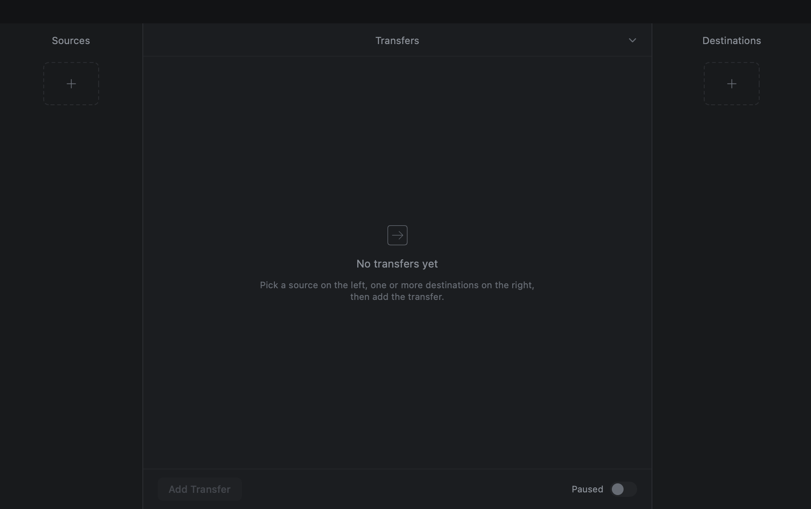

# Phase 2: the Offload window

**Answer: the window exists, is native, and drives the same engine the CLI uses.**
Screenshots below are rendered from the shipping view code, not mocked up.

Run 2026-10-25 on arm64 macOS 26.5.2, FreeFileSync `v14.12` (`53143e29`) + the port.


---

## 1. The decision this phase forced

Phase 1 ended with a choice I could not make for you: wxWidgets on the port, or a native
shell. **Taken: the native shell.**

Why, concretely:

- The reference UI is a dark, custom-drawn three-pane window. In wxWidgets every control
  would be painted by hand to match it — so the "toolkit gives us the look" argument does
  not apply here anyway.
- wx would also mean porting `ui/` (6,493 lines in `main_dlg.cpp` alone) to a platform it
  has never compiled on. That is the single largest unknown left in the project, and it
  buys a look we would then overpaint.
- A C ABI boundary gives something wx does not: one transfer per thread, so per-row pause
  and cancel are local, and a stalled spinning drive cannot block the window.

Cost, stated plainly: **FreeFileSync's own sync window still does not run on macOS.** The
fork carries the engine and Offload; it is not "FreeFileSync for Mac".

## 2. What is on screen

| Region | Behaviour |
|---|---|
| **Sources** (left) | Drop a card or folder, or use the dashed tile. Tile shows name + capacity; selected tiles get a ring. `DCIM` at the root marks a card glyph, a mount point a drive. |
| **Transfers** (middle) | One row per `source → dest · subfolder`: bar, current file, moving-average rate, ETA, per-row pause and cancel. **Add N Transfers** builds the `sources × destinations` product. **Paused** stops everything. |
| **Destinations** (right) | Drop a drive or pick one. Capacity on the tile; the engine writes into `<dest>/<source name>/`. |

Bar colours follow the engine's own vocabulary: blue copying, light-blue verifying, green
verified, red failed/mismatch, grey cancelled.



## 2a. The fit check

A card that does not fit its destination is the failure that ruins a shoot, so the
window refuses to start it:


- The required size comes from `offload::measureSource()` — the **same** walk and junk
  rules the copy uses, exposed through the C ABI. The fit check cannot disagree with the
  job, because there is only one interpretation of "what will be copied".
- A source that is being measured shows `Measuring the source…` and the button stays
  disabled; an unknown size never silently becomes "0 bytes, fits".
- A destination that is short is ringed amber, labelled with the shortfall, and blocks
  **Add Transfer**; free space is re-read at the moment of the decision, not cached.
- A destination that is gone reads `Not connected` and also blocks.
- A source that *cannot be measured* is not refused — it warns `Size unknown … — fit not
  checked` — because "unknown" is not the same claim as "doesn't fit".

The rule lives in `FitCheck.verdict(required:free:)`, a pure function, so it is tested
without a window (`--fit-test`, 11 boundary checks: exactly fits, one byte short,
shortfall arithmetic, empty source, unmeasured source, volume reporting nothing, and the
blocking policy for each verdict).

**Refusal verified against a real volume**, not a mock: a 60 MB APFS disk image cannot
hold the 94.1 MB card.

```
$ ./Offload --self-test /tmp/offload-card /Volumes/TightOffload
source: 94.1 MB in 33 files
fit: /Volumes/TightOffload is 32 MB short — refusing before writing anything
exit=1
$ ls -A /Volumes/TightOffload | wc -l
0
```

## 3. How progress actually reaches the window

Three layers, each with one job:

1. **Engine** (`offload/engine.cpp`): a `Sink` owned by each destination's worker. It
   counts planned bytes up front (Duplicate Detect means the denominator excludes files
   that will be skipped), adds bytes as they are written, adds them again on the read-back
   pass, and emits at most every 80 ms plus once per file boundary. No locks.
2. **C ABI** (`offload/capi.cpp`, 289 lines): `offload_job_start/poll/pause/cancel/destroy`
   over an opaque handle. Poll copies a plain struct under one mutex; pause and cancel are
   atomics, so the UI never blocks on the engine.
3. **Window** (`offload/mac/`, SwiftUI): polls all live transfers at 10 Hz, keeps a 0.7/0.3
   moving average for the rate, and derives ETA from it.

Why this and not file-system polling: the engine already knows the exact byte count, so
the bar is monotonic and reaches 100% only when the read-back pass finished — the number
means "verified", not "wrote something".

## 4. Evidence

**Build, from a clean clone** (not incremental, not this working tree):

```
$ git clone --depth 1 --branch v14.12 … && git apply full-port-and-offload.patch
applies cleanly to v14.12 (53143e2)
$ make -f Makefile.macos liboffloadapi.a ffsoffload ffsoffload_tests   → rc 0
$ ./ffsoffload_tests                                                   → 100/100 checks passed
$ cd offload/mac && make Offload.app                                   → Offload.app (ad-hoc signed)
```

**Transfer through the window's own code path** (`--self-test` constructs the same
`EngineJob`/`Transfer` objects the rows use):

```
card: 35 entries on disk, 33 after card-junk filtering, 94.1 MB
$ ./Offload --self-test /tmp/offload-card /tmp/t1 /tmp/t2
  t1: 33 verified of 33, report …/job0/report.csv
  t2: 33 verified of 33, report …/job1/report.csv
self-test PASS                                    wall 0.24 s (both destinations)

$ ./Offload --self-test /tmp/offload-card2 /tmp/d        # single 700 MB clip
  d: 7 verified of 7                              wall 0.66 s, peak RSS 19.1 MB
```

`.ffsoffload.mhl` at both destination roots, `report.csv`/`report.json` per job:

```xml
<hashlist version="1.1">
  <creatorinfo>… <verification>Source &amp; Destination</verification></creatorinfo>
  <hash><file>DCIM/100CANON/IMG_4000.CR3</file><size>539563</size>
        <xxh64>eb21fdb46837298f</xxh64></hash>
```

**The measurement the fit check trusts equals what the job copied** (`tests.cpp`,
`testMeasureSource`): on a 4-file fixture with `.DS_Store` and an AppleDouble sidecar,
`measureSource()` returns the same byte total and file count as the verified records
from a real run, and fails loudly on a folder that does not exist. 107/107 assertions.

**Live progress is real, not a spinner.** Sampling the 700 MB clip mid-run:

```
offload-dest-c   0% 0/7 files Preparing…
offload-dest-c  50% 0/7 files Verifying · about 0 seconds (1.7 GB/sec)
```

`0 seconds` was a bug — sub-second ETAs said "about 0 seconds"; fixed to say nothing.

**App bundle runs:** launched `Offload.app/Contents/MacOS/Offload`, still alive after 4 s
with nothing on stderr, then stopped by PID.

## 4a. Driving the window with the mouse


That image is the **running window**, captured from its own view hierarchy right after
`make ui-test` finished — two rows created by clicking **Add Transfers**, both green.

SwiftUI ignores synthetic `NSEvent`s handed to its hosting view (proved with a 20-line
standalone app that ignored the identical clicks), so the window is driven from outside
with real `CGEvent`s:

- Every clickable view publishes its frame (`.testAnchor` → `AnchorFrames`).
- `Offload --ui-serve <state.json>` opens the real window on a fixture and writes those
  frames, converted to global display points, plus its state, every 150 ms.
- `clickdriver --state <state.json>` reads the file, posts mouse-moved/down/up at each
  published point, then re-reads the file and asserts what changed.

```
$ make ui-test
   click dst-tile-1 at (1038, 426)
   ok   clicks cleared the preselected devices
   ok   clicking a source tile selects it
   ok   clicking it again deselects it
   ok   clicking a destination tile selects it
   ok   a second destination adds to the selection
   ok   Add Transfers created one row per destination (got 2)
   ok   the row's pause button paused that job in the engine
   ok   clicking it again resumed the job
   ok   the row's cancel button reached the engine
   ok   both destinations are now deselected
   ok   Add does nothing when nothing is selected
   ok   the window still responds after that

12/12 mouse checks passed
```

This needs Accessibility permission for the app running the test (System Settings →
Privacy & Security → Accessibility → Freebuff); without it macOS drops posted events
silently. It passed from a clean `v14.12` clone + patch as well.

What it caught: device tiles were named after the **volume** rather than the folder, so
every folder on the boot disk read `Macintosh HD`. Fixed — a folder is named after
itself, only a mount point takes the volume's name.

What it does not cover: drag & drop from Finder (a separate code path that synthesis
can't fake convincingly), and anything needing Screen Recording.

## 5. What is *not* verified

- **Dragging a card in from Finder.** Clicking, pausing and cancelling are now driven
  with real events (section 4a); dropping a folder from another app is not, and it is the
  one interaction that still rests on the drop handler being correct by inspection.
- **Real hardware.** Every run used synthetic files in `/tmp`. No real card, no real SSD,
  no spinning archive drive, no unplugging mid-copy.
- **ETA accuracy.** Computed from a moving average that includes the verification pass at
  copy speed, so it reads optimistically on a slow destination.
- **Fit check against real drives.** The arithmetic and the refusal are proven against a
  disk image; what is untested is behaviour when free space changes *during* a run
  (another app writing to the same drive), which currently only trips the engine's
  ordinary write error, not the pre-flight.

## 6. Files

| Path | What |
|---|---|
| `offload/capi.h`, `offload/capi.cpp` | the C ABI (429 lines) |
| `offload/mac/Views.swift` | the three panes, rows, glyphs, warnings (668 lines) |
| `offload/mac/Model.swift` | devices, transfers, polling, rate/ETA, fit rule (618 lines) |
| `offload/mac/Engine.swift` | Swift wrapper over the C ABI, source measurement (92 lines) |
| `offload/mac/Entry.swift` | app entry, `--render`, `--self-test`, `--fit-test`, `--ui-serve` |
| `offload/mac/UITest.swift` | click anchors + published state for the mouse test |
| `offload/mac/clickdriver.swift` | posts real CGEvents and checks what changed (191 lines) |
| `offload/mac/Makefile` | builds `Offload.app`; `make screenshot`, `make test` |
| `offload/patches/full-port-and-offload.patch` | 38 files, applies to v14.12 |

Build it:

```bash
cd FreeFileSync/Source && make -f Makefile.macos liboffloadapi.a
cd offload/mac && make            # Offload.app
make screenshot                   # render the window offscreen
```
